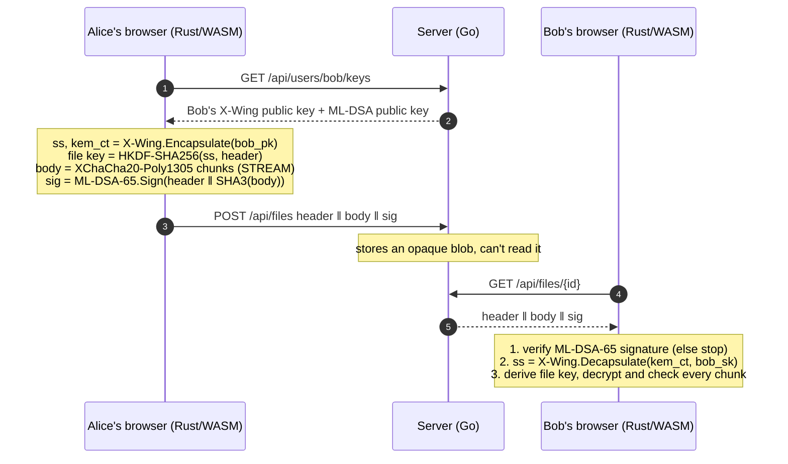
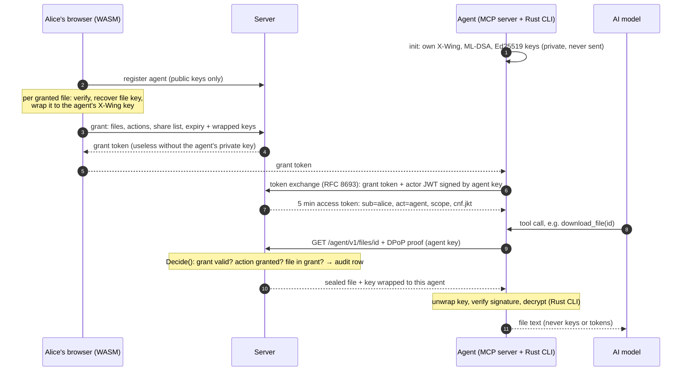

# SealDrop

**Post quantum end to end encrypted file sharing, unlocked with a passkey.**

> **⚠️ NOT AUDITED.** SealDrop is a learning and portfolio project. It has not been reviewed by professional cryptographers. Do not use it to protect real secrets.

**Live demo:** https://sealdrop.onrender.com (Render free tier: the first request after idle can take about a minute, and the demo database is wiped whenever the service restarts.)


## Contents

1. [What it does](#what-it-does)
2. [Results at a glance](#results-at-a-glance)
3. [Try it](#try-it): the live demo, a walkthrough with screenshots
4. [How it works](#how-it-works): the protocol step by step
5. [Run it locally](#run-it-locally)
6. [Examples](#examples): Rust API, browser (WASM) API, HTTP API
7. [Testing](#testing): known answer tests, tamper tests, end to end, zero knowledge check, fuzzing, benchmarks
8. [AI agents](#ai-agents-delegated-scoped-revocable-access): delegated, scoped, revocable access
9. [Deploying](#deploying)
10. [Repository layout](#repository-layout)
11. [Security model and limitations](#security-model-and-limitations)
12. [Documentation](#documentation)

## What it does

| | |
|---|---|
| 🔒 **Zero knowledge server** | Files are encrypted in your browser. The server stores ciphertext, public keys and *wrapped* private keys, and nothing it stores can be decrypted without a user's passkey. |
| 🛡️ **Post quantum encryption** | **X-Wing** (`draft-connolly-cfrg-xwing-kem-11`) combines X25519 with **ML-KEM-768** (NIST FIPS 203). An attacker must break *both*, so files recorded today stay safe from a future quantum computer ("harvest now, decrypt later"). |
| ✍️ **Post quantum signatures** | Every file is signed with **ML-DSA-65** (NIST FIPS 204). The recipient verifies who sent it, and that nothing changed, *before* decrypting a single byte. |
| 🔑 **No passwords** | You sign in with a **passkey** (WebAuthn). The passkey's **PRF extension** produces a secret that only your authenticator can compute, and that secret unlocks your private keys. It never leaves your browser. If your browser or passkey has no PRF support, a passphrase fallback is available, clearly labeled weaker. |
| 🦀 **One crypto core** | All cryptography is in one small Rust library (`core/`), compiled to WebAssembly for the browser. JavaScript only moves bytes around. |
| ✅ **Proven by official vectors** | X-Wing draft vectors and NIST ACVP ML-DSA-65 vectors, plus tamper, fuzz and end to end tests. |

## Results at a glance

Every number comes from a real run. The raw outputs are in [`outputs/`](outputs/), and [`outputs/results.md`](outputs/results.md) is generated from them by [`scripts/make_results.py`](scripts/make_results.py).

| | |
|---|---|
| Official test vectors passed | **{N}** (X-Wing draft-11: {XW} · NIST ACVP ML-DSA-65: {MLDSA}) |
| Fuzzing (libFuzzer + AddressSanitizer, 3 targets × 30 min) | **{E}** executions, **{C}** crashes |
| Sealed file with one bit flipped, tried in every byte position | **{FLIPS}** rejected |
| X-Wing encapsulate + decapsulate | {X} (X25519 alone: {X_CL}) |
| ML-DSA-65 sign / verify | {S} / {V} (Ed25519: {S_CL} / {V_CL}) |
| Encrypt + sign a 16 MiB file | {Y} · {Z} the time of the same format using X25519 + Ed25519 |
| In the browser (WASM), 1 MiB seal / open | {BROWSER} |
| Size overhead per file | 4522 bytes + 16 bytes per 64 KiB chunk |
| End to end test (real browser, virtual passkeys) | {E2E} |


The post quantum cost is real but small in absolute terms: well under a millisecond for key exchange, and a millisecond or two for the signature. On large files the work is dominated by symmetric encryption and hashing, which both versions share.

## Try it

Open **https://sealdrop.onrender.com** in a current Chrome, Edge or Safari. You need a passkey provider: your phone, Windows Hello, iCloud Keychain, Google Password Manager, or a security key. To see the sharing flow, open a second browser profile (or a private window) as the other user.

### 1. Create an account with a passkey

Type a username (3–32 characters: `a-z 0-9 _`) and press **Create account with passkey**. Your browser asks you to create a passkey. SealDrop then:
1. generates your post quantum keys in the page (X-Wing + ML-DSA-65),
2. asks the passkey for its PRF output and turns it into a wrapping key (HKDF),
3. uploads your public keys and your private keys **wrapped** under that key.


### 2. Send a file

Enter the recipient's username, pick a file and press **Encrypt, sign and upload**. The log shows the recipient's key fingerprint (compare it with them out of band), how long encrypt + sign took, and how many bytes of overhead were added. The file list shows "only bob can decrypt", and that is true even for you as the sender.

### 3. Receive and decrypt

The recipient signs in (on any device where their passkey works), opens **Files** and presses **Decrypt**. The page fetches the sender's public key, verifies the ML-DSA-65 signature, and only then decrypts and saves the file.


### 4. No server needed: the local demo

The **Local demo** card makes two throwaway identities in the tab, encrypts from one to the other, decrypts, and then flips one bit to show that a tampered copy is rejected. **Benchmark** measures encryption speed in your browser.


### 5. When PRF isn't available

Some browser and authenticator combinations don't support PRF. SealDrop then says so plainly and offers a passphrase (at least 12 characters, stretched with Argon2id) as a **weaker** fallback.


## How it works



**Your keys.** Your private identity is just 64 random bytes: a 32 byte X-Wing seed and a 32 byte ML-DSA seed. Both keypairs are derived from it, and the server stores it only wrapped:

```
passkey ──PRF(salt)──▶ 32 B secret (browser only)
        ──HKDF-SHA256──▶ wrapping key
        ──XChaCha20-Poly1305(aad = username)──▶ wrapped identity (126 B, stored on server)
```

**The file format** (`SDRP` v1) is a 1213 byte header (version, chunk size, sender and recipient key fingerprints, the 1120 byte X-Wing ciphertext, a nonce prefix), then the encrypted chunks, then a 3309 byte ML-DSA-65 signature. Each chunk's nonce contains its index and a "last chunk" flag, so chunks can't be reordered, duplicated or cut off. The byte-level layout is in [docs/DESIGN.md](docs/DESIGN.md#5-message-formats).

**Why both an encryption key and a signing key?** The KEM gives *confidentiality*: only Bob can read the file. But anyone can encrypt to Bob's public key, so encryption alone can't prove who sent the file. The signature gives *authenticity*. SealDrop uses the NIST post quantum standard for each job: ML-KEM (inside X-Wing) and ML-DSA.

## Run it locally

**Requirements:** Rust stable (and nightly only for fuzzing), [`wasm-pack`](https://github.com/rustwasm/wasm-pack), Go 1.22+, Node 20+. On Windows, Rust needs the Visual Studio C++ build tools.

```bash
git clone https://github.com/WildTiger15/sealdrop && cd sealdrop
```

Build the browser client (Rust → WebAssembly → Vite):

```bash
cd web && npm install && npm run wasm && npm run build && cd ..
```

Start the server, which serves both the API and the client:

```bash
cd server && go run . -static ../web/dist
```

Open http://localhost:8080. (Passkeys only work on `localhost` or HTTPS.)

Or run everything in Docker, the same image Render uses:

```bash
docker build -t sealdrop . && docker run --rm -p 8080:8080 -e PORT=8080 sealdrop
```

**Server options** (flag, or environment variable):

| Flag | Env | Default | Meaning |
|---|---|---|---|
| `-addr` | `PORT` → `:$PORT` | `localhost:8080` | listen address |
| `-origin` | `SEALDROP_ORIGIN`, or `RENDER_EXTERNAL_URL` | `http://localhost:8080` | public origin. The passkey RP ID is its hostname |
| `-db` | `SEALDROP_DB` | `data/sealdrop.db` | SQLite file |
| `-static` | `SEALDROP_STATIC` | `../web/dist` | built web client |

## Examples

### Rust: the core library

[`core/examples/quickstart.rs`](core/examples/quickstart.rs) walks through the whole API:

```rust
use sealdrop_core::{file, identity::SecretIdentity};

let alice = SecretIdentity::generate()?;   // X-Wing + ML-DSA-65 keys from 64 random bytes
let bob = SecretIdentity::generate()?;

// Alice: encrypt for Bob and sign.
let sealed = file::seal(b"Meet at the usual place at 10.", &bob.public().kem_pk, &alice)?;

// Bob: verify Alice's signature, then decrypt. Any tampering returns an error, never plaintext.
let plaintext = file::open(&sealed, &bob, &alice.public().sig_vk)?;
```

```bash
cargo run -p sealdrop-core --example quickstart --release
```

Real output ([`outputs/example-quickstart.txt`](outputs/example-quickstart.txt)):

```
{QUICKSTART}
```

Errors are deliberately coarse (`InvalidKey`, `InvalidFormat`, `BadSignature`, `DecryptionFailed`, `Randomness`), so a failure never reveals which secret-dependent step went wrong.

### Browser: the WebAssembly API

`wasm/` exports the same operations to JavaScript (see [`web/src/main.ts`](web/src/main.ts)):

```ts
import init, * as sd from "./pkg/sealdrop_wasm.js";
await init();

const alice = sd.generateIdentity();          // Uint8Array(64), keep it in memory only
const bob = sd.generateIdentity();

const sealed = sd.seal(fileBytes, sd.publicKemKey(bob), alice);
const back = sd.open(sealed, bob, sd.publicSigKey(alice));   // throws on any tampering

// Protect an identity with passkey PRF output (or sd.wrapWithPassphrase as the fallback)
const blob = sd.wrapWithPrf(prfOutput, alice, "alice");
const again = sd.unwrapWithPrf(prfOutput, blob, "alice");
```

### HTTP API

| Method | Path | Auth | What it does |
|---|---|---|---|
| POST | `/api/register/begin` · `/finish` | none | create a passkey (WebAuthn, PRF requested) |
| POST | `/api/login/begin` · `/finish` | none | sign in with a passkey (PRF evaluated) |
| POST | `/api/logout` | session | end the session |
| GET | `/api/me` | session | your username and wrapped keys |
| PUT | `/api/me/keys` | session | publish public keys + wrapped private keys (**once only**) |
| GET | `/api/users/{name}/keys` | none | someone's public keys |
| POST | `/api/files` | session | upload a sealed file `{recipient, blob}` |
| GET | `/api/files` | session | files you sent or received |
| GET | `/api/files/{id}` | session | download, only if you are its sender or recipient |

Anyone can fetch public keys:

```bash
curl https://sealdrop.onrender.com/api/users/alice/keys
```

```json
{"username":"alice","kem_pk":"<1216 bytes, base64>","sig_vk":"<1952 bytes, base64>"}
```

Every other endpoint needs the passkey-backed session cookie (`HttpOnly`, `SameSite=Strict`). The server checks only the shape of what you upload: it must start with `SDRP` and be at least the minimum sealed size. It can't check, or read, anything inside.

## Testing

| Suite | Command | What it proves |
|---|---|---|
| Rust core (KATs, round trips, tampering) | `cargo test -p sealdrop-core -- --nocapture` | the crypto is correct on official inputs, and every failure case fails |
| Go server | `cd server && go test ./...` | auth required, keys set once, access control, input validation |
| End to end | `cd web && npm run build && npm run e2e` | real browser + real server + virtual passkeys, plus the zero knowledge dump |
| Agents (M7) | `cd web && npm run build && node e2e/agents.mjs mcp attacks agent-run` | MCP tools, 27 attack attempts, real agent run with prompt injection, zero knowledge dump |
| Policy timing | `cd server && SEALDROP_TIMING_OUT=../outputs/policy-timing.json go test -run TestPolicyTiming` | median `Decide()` time |
| Live smoke test | `cd web && npm run smoke` (or `npm run smoke -- <url>`) | the deployed site: two new users, passkeys with PRF, send and decrypt ([output](outputs/live-smoke.txt)) |
| Fuzzing | `cd core && cargo +nightly fuzz run decrypt` (also `decapsulate`, `verify`) | parsers never crash on hostile input |
| Benchmarks | `cargo bench -p sealdrop-core` | the numbers above |
| Results file | `python -I scripts/make_results.py && python -I scripts/make_charts.py` | regenerates `outputs/results.md`, README numbers and charts |

### Known answer tests (official vectors)

* **X-Wing:** the three vectors in Appendix C of draft-11 were extracted mechanically from the draft text into [`core/tests/vectors/xwing-draft-11.json`](core/tests/vectors/xwing-draft-11.json), with every field length checked against §5.1. For each one, the test checks the derived public key, the ciphertext and shared secret from `EncapsulateDerand`, and the shared secret from `Decapsulate`.
* **ML-DSA-65:** the NIST ACVP-Server `internalProjection.json` files for keyGen, sigGen and sigVer, filtered to ML-DSA-65 ([`core/tests/vectors/ml-dsa-65-acvp.json`](core/tests/vectors/ml-dsa-65-acvp.json), source commit recorded inside). sigVer includes 36 signatures that **must be rejected**. HashML-DSA (pre-hash) cases are excluded because SealDrop doesn't use that mode.

```
{KAT_LINES}
```

### Tamper and failure tests

From [`core/tests/file.rs`](core/tests/file.rs), [`keywrap.rs`](core/tests/keywrap.rs), [`xwing.rs`](core/tests/xwing.rs) and [`mldsa.rs`](core/tests/mldsa.rs). Each of these must fail, and does:

| Attack | Expected result |
|---|---|
| flip one bit in **every byte** of a sealed file, one copy at a time | rejected ({FLIPS}) |
| open with the wrong recipient key | `DecryptionFailed` |
| eve signs, but bob checks against alice's key | `BadSignature` |
| eve copies alice's fingerprint into the header | `BadSignature` |
| change the header, KEM ciphertext, nonce or body | `BadSignature` |
| truncate the file or the signature | error |
| drop the last chunk, or swap two chunks (signature bypassed) | `DecryptionFailed` (STREAM) |
| wrong version or magic | `InvalidFormat` |
| tampered X-Wing ciphertext (ML-KEM or X25519 part) | different shared secret |
| invalid ML-KEM public key (FIPS 203 §7.2 modulus check) | rejected |
| unwrap keys with the wrong key or under another username | `DecryptionFailed` |

### End to end with real passkeys

[`web/e2e/e2e.mjs`](web/e2e/e2e.mjs) starts a fresh server and drives Microsoft Edge with Playwright. Each user gets a **DevTools virtual authenticator** with PRF support, so no hardware key is needed. Real output ([`outputs/e2e.txt`](outputs/e2e.txt)):

```
{E2E_LINES}
```

The last step is the **zero knowledge check**: [`server/cmd/dbdump`](server/cmd/dbdump/main.go) dumps every table the way an attacker who stole the database would see it. It searches every column for the plaintext the test uploaded, and checks that the stored blobs look like ciphertext (correct magic, about 8 bits of entropy per byte).

### Fuzzing

Three [cargo-fuzz](https://github.com/rust-fuzz/cargo-fuzz) targets in [`core/fuzz/`](core/fuzz/fuzz_targets/) feed hostile bytes, under AddressSanitizer, to everything that parses untrusted input:

* `decrypt`: `file::open`, `file::peek_header`, the chunk decryptor, key unwrap
* `decapsulate`: X-Wing decapsulation with arbitrary ciphertexts, and encapsulation to arbitrary public keys
* `verify`: ML-DSA-65 verification with arbitrary signatures, messages and public keys

```bash
cd core && cargo +nightly fuzz run decrypt -- -max_total_time=1800
```

Result: **{E}** executions in total, **{C}** crashes. On Windows, put the MSVC AddressSanitizer runtime (`clang_rt.asan_dynamic-x86_64.dll`, in `VC/Tools/MSVC/<ver>/bin/Hostx64/x64`) on `PATH`.

### Benchmarks

```bash
cargo bench -p sealdrop-core
```

This compares X-Wing with plain X25519, ML-DSA-65 with Ed25519, and SealDrop's full seal with the same file format built from X25519 + Ed25519. Laptop numbers move around between runs, so treat them as rough. The full tables are in [`outputs/results.md`](outputs/results.md).

## AI agents: delegated, scoped, revocable access

AI agents get **their own identity**. You can give one access to **specific files, specific actions, until a time you choose**, and take it back at any moment. Every request is recorded as *which agent acted, for whom*. The agent never gets your keys or a shared long-lived credential, and the server still never sees plaintext. The full design is in [docs/AGENTS.md](docs/AGENTS.md).



| Piece | What it does |
|---|---|
| **Agent identity** | `python -m sealdrop_agent init` generates the agent's keys locally (X-Wing + ML-DSA-65 via the Rust core, Ed25519 for auth). You register only the public bundle. |
| **Grants** | Deny by default: exact file ids (only files sent to you), actions from `list · download · upload · share`, allowed share recipients, expiry of 1 min to 24 h. |
| **Tokens** | OAuth 2.0 **token exchange** (RFC 8693) issues 5-minute JWTs with the **`act` claim** (agent acting for user), bound to the agent's key with **DPoP** (RFC 9449). Refreshing only works while the grant is valid. All signing uses `golang-jwt` / PyJWT. |
| **One policy check** | `Decide()` in [`server/policy.go`](server/policy.go): every agent request passes through it, after token and DPoP checks and with the grant reloaded fresh. |
| **Key wrapping** | For granted files only, your browser wraps each file key to the agent's X-Wing key, bound to that file and that agent ([`core/src/delegate.rs`](core/src/delegate.rs)). |
| **Revocation** | One click stops new tokens, kills existing ones on their next request, and deletes the agent's wrapped keys. |
| **Audit log** | Agent, user acted for, action, file, decision and reason for every request and token exchange, at `/audit.html`. Fails closed. |
| **MCP server** | [`mcp/`](mcp/): official MCP Python SDK with tools `list_files`, `download_file`, `upload_file`, `share_file`. Crypto runs in a Rust CLI over stdin/stdout. Keys and tokens never appear in tool results. |
| **Observability** | JSON logs with request ids, Prometheus `/metrics`, `/healthz`. |

### Attack results

Every attack ran against a real server, with real agents and grants created through the web UI ([`web/e2e/agents.mjs`](web/e2e/agents.mjs), [`mcp/tests/attacks.py`](mcp/tests/attacks.py)):

**{ATT_BLOCKED} of {ATT_TRIED} attack attempts blocked**: expired token and DPoP proof replay, actions and files outside the grant, agent A using agent B's tokens, forged and tampered tokens (`alg: none`, HS256 key confusion, edited claims, attacker-signed), and access after revocation. Note: {AGENT_RUN_STATUS}.

```
{ATTACK_LINES}
```

**Policy check time:** a median of **{DECIDE_NS} ns** per `Decide()` call for an allowed request, and **{DECIDE_DENY_NS} ns** for a denial that runs every check. A whole agent request (DPoP signing, HTTP, token verification, grant load, policy, audit write) takes a median of **{AGENT_REQ_MS}** on localhost. Details are in [`outputs/results.md`](outputs/results.md).

### Use it with an MCP client

```bash
cd mcp && python -m venv .venv && .venv/Scripts/pip install -r requirements.txt
```

```bash
python -m sealdrop_agent init --name "Research bot"
```

Paste the printed public bundle into **AI agents** on the site, and note the agent id it assigns. Then:

```bash
python -m sealdrop_agent set-agent-id agt_...
```

Create a grant in **Grant an agent access**, save the grant token to a file, and load it from stdin so it never lands in shell history:

```bash
python -m sealdrop_agent set-grant < grant-token.txt
```

MCP client configuration (Claude Code, Claude Desktop, …):

```json
{ "mcpServers": { "sealdrop": {
    "command": "<repo>/mcp/.venv/Scripts/python", "args": ["-m", "sealdrop_agent", "serve"],
    "env": { "PYTHONPATH": "<repo>/mcp", "SEALDROP_URL": "https://sealdrop.onrender.com" } } } }
```

## Deploying

The repository includes a multi-stage [`Dockerfile`](Dockerfile): Rust → WebAssembly, Vite → static files, Go → a static binary, all in a distroless non-root image. On **Render**, create a *Web Service* from the repo with runtime **Docker**. The server picks up Render's `PORT` and `RENDER_EXTERNAL_URL` by itself, and passkeys are bound to that hostname. Two notes for the free plan:
* the instance sleeps when idle, so the first request takes a while;
* the SQLite database lives in `/tmp` and disappears on restart. For a persistent setup, attach a disk and set `SEALDROP_DB` to a path on it.

Production also needs HTTPS (Render provides it). Passkeys refuse plain HTTP anywhere other than localhost.

## Repository layout

```
core/            Rust crypto core
  src/xwing.rs     X-Wing hybrid KEM (draft-11, each section quoted in comments)
  src/sign.rs      ML-DSA-65 signatures
  src/file.rs      sealed file format (header, STREAM chunks, signature)
  src/keywrap.rs   wrapping private keys under a PRF or passphrase key
  src/identity.rs  a user's two keypairs
  tests/           official vectors + tamper tests      benches/  criterion
  examples/        quickstart.rs                        fuzz/     cargo-fuzz targets
wasm/            wasm-bindgen wrapper for the browser
server/          Go server: passkeys (go-webauthn), SQLite, cmd/dbdump,
                 agents, grants, OAuth token exchange, policy.go, audit, metrics
cli/             sealdrop-agent: Rust CLI the agent uses for crypto
mcp/             Python MCP server for AI agents (official MCP SDK); tests/ attacks, agent run
web/             TypeScript + Vite client; e2e/ Playwright tests and screenshots
docs/            DESIGN, THREAT_MODEL, CRYPTO_REVIEW, primers, images
outputs/         raw results: tests, benchmarks, fuzzing, e2e, results.md
scripts/         regenerate results.md, README numbers and charts
Dockerfile       the image deployed to Render
```

Crate and module versions (latest stable when chosen): `ml-kem 0.3.3`, `ml-dsa 0.1.1`, `x25519-dalek 3.0.0`, `chacha20poly1305 0.11.0`, `hkdf 0.13.0`, `sha3 0.12.0`, `argon2 0.6.0`, `zeroize 1.9.1`, `subtle 2.6.1`; Go `go-webauthn v0.18.2`, `modernc.org/sqlite v1.61.0`.

## Security model and limitations

**Protected:** file contents and private keys against a full **database breach** (for passkey PRF users); confidentiality against a **future quantum attacker** (if ML-KEM-768 holds); **impersonation** and **tampering** (ML-DSA-65 + AEAD + STREAM); **phishing** (passkeys are bound to the site).

**Not protected:**
* **Metadata**: the server knows who sends to whom, when, and exact file sizes.
* **A malicious or compromised server** could serve modified JavaScript or swap a user's public key. Compare key fingerprints out of band. Key pinning and key transparency are future work.
* **Compromised devices**: malware, or an unlocked stolen device.
* No forward secrecy for stored files, no key rotation, no multi-device sync. Whole files are held in memory.
* The passkey itself (usually ECDSA P-256) isn't post quantum. It guards sign in, not stored ciphertext.
* Passphrase fallback users are open to offline guessing if the database leaks (slowed by Argon2id).
* The `ml-kem` and `ml-dsa` crates are young and unaudited too. Vectors prove correctness on official inputs, not resistance to side channels.

The full analysis is in [docs/THREAT_MODEL.md](docs/THREAT_MODEL.md), and the self review with line references is in [docs/CRYPTO_REVIEW.md](docs/CRYPTO_REVIEW.md).

## Documentation

* [docs/DESIGN.md](docs/DESIGN.md): goals, components, formats, key hierarchy, algorithm choices (RFC style)
* [docs/THREAT_MODEL.md](docs/THREAT_MODEL.md): assets, attackers, what is and isn't protected
* [docs/CRYPTO_REVIEW.md](docs/CRYPTO_REVIEW.md): the hygiene checklist applied to this code, plus what to fix next
* [docs/PRIMER.md](docs/PRIMER.md): KEMs, hybrid encryption, AEAD, HKDF, constant time, in plain language
* [docs/AGENTS.md](docs/AGENTS.md): delegated access for AI agents (identities, grants, token exchange, DPoP, policy, audit, MCP)
* [docs/PRIMER_AGENTS.md](docs/PRIMER_AGENTS.md): authentication vs authorization, token exchange, JWTs, least privilege
* [PLAN.md](PLAN.md): the milestone plan

## License

MIT. See [LICENSE](LICENSE).
